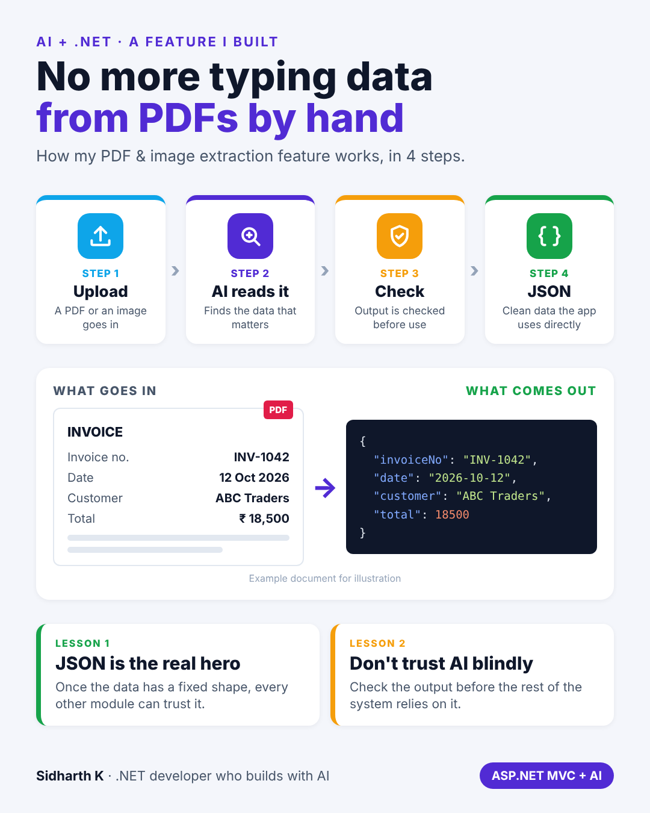

# No more typing data from PDFs by hand

- **Date:** Mon 26 Oct 2026, 9:00 AM IST
- **Format:** Image + caption
- **Status:** Ready




## Caption

```
One of the features I'm proudest of started with a boring problem: people typing data from PDFs into a system by hand.

So I built a feature that does it for them.

Upload a PDF or an image. AI reads it. The output is checked. Clean JSON comes out, and the rest of the ASP.NET app uses it directly.

The AI part gets the attention. But the JSON is the real hero.

If you've added AI to a business app, what turned out harder than you expected?

#AI #dotnet #Automation
```
