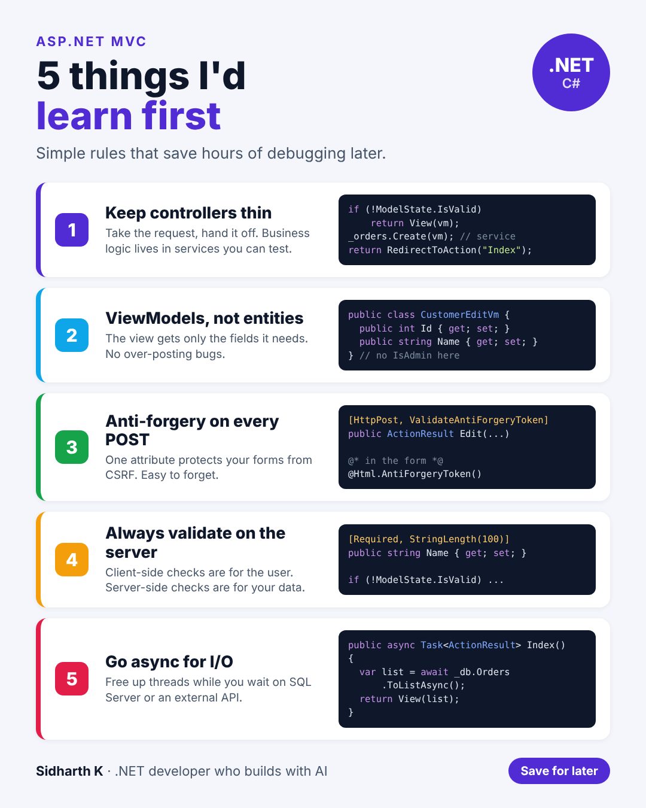

# 5 ASP.NET MVC things I'd learn first

- **Date:** Thu 29 Oct 2026, 9:00 AM IST
- **Format:** Image + caption
- **Status:** Ready




## Caption

```
If I were starting with ASP.NET MVC today, these are the 5 things I'd learn first.

None of them are advanced. All of them save hours of debugging later.

Number 3 is the easiest one to forget: one attribute, and your forms are protected from CSRF.

Save this for your next project.

What's the one tip you'd give someone on their first day with ASP.NET MVC?

#aspnet #dotnet #WebDevelopment
```
