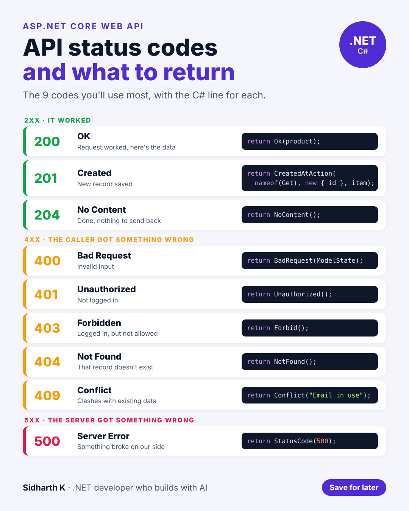

# API status codes in ASP.NET

- **Date:** Thu 5 Nov 2026, 9:00 AM IST
- **Format:** Image + caption
- **Status:** Ready




## Caption

```
Returning 200 for everything, even errors, is a common API mistake.

Status codes are how your API talks to the apps calling it. Get them right and the front end knows exactly what happened without reading your error text.

Here are the 9 codes you'll use most, with the one line of C# that returns each in ASP.NET Core.

The quick rule:
2xx = it worked
4xx = the caller got something wrong
5xx = we got something wrong

Save this for your next API.

Which status code do you see misused the most?

#dotnet #API #WebDevelopment
```
