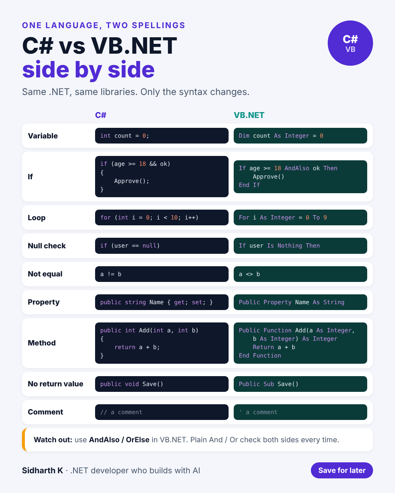

# C# vs VB.NET side by side

- **Date:** Thu 12 Nov 2026, 9:00 AM IST
- **Format:** Image + caption
- **Status:** Ready




## Caption

```
I write both C# and VB.NET at work.

People are often surprised that they're the same .NET underneath. Same framework, same libraries, same performance. Only the syntax changes.

If you know one, you can read the other in an afternoon. This sheet puts the most common syntax side by side.

One VB.NET trap worth knowing: use AndAlso and OrElse, not And and Or. The plain versions check both sides every time, which can throw a null error you didn't expect.

Save it if you ever have to jump into a legacy VB.NET project.

C# or VB.NET: which one did you learn first?

#dotnet #csharp #vbnet
```
