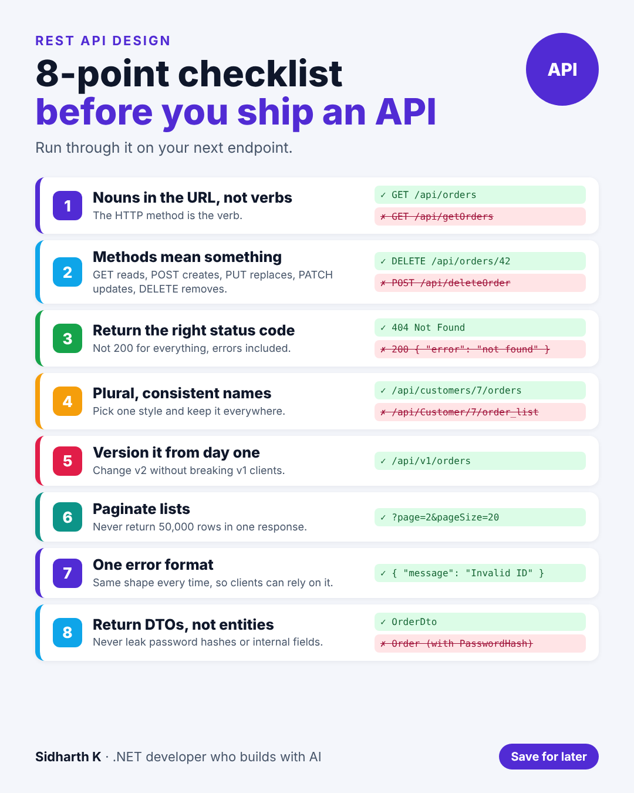

# REST API design checklist

- **Date:** Thu 19 Nov 2026, 9:00 AM IST
- **Format:** Image + caption
- **Status:** Ready




## Caption

```
A messy API makes everyone's job harder: the front end, the mobile app, and you six months from now.

Before I call an endpoint done, I run through 8 checks:

Nouns in the URL. Methods that mean something. The right status codes. Consistent names. A version number. Pagination. One error format. DTOs instead of entities.

None of these are hard. They just have to be done from the start, because changing an API later breaks the apps that use it.

Save it for your next endpoint.

What would you add as number 9?

#API #dotnet #WebDevelopment
```
