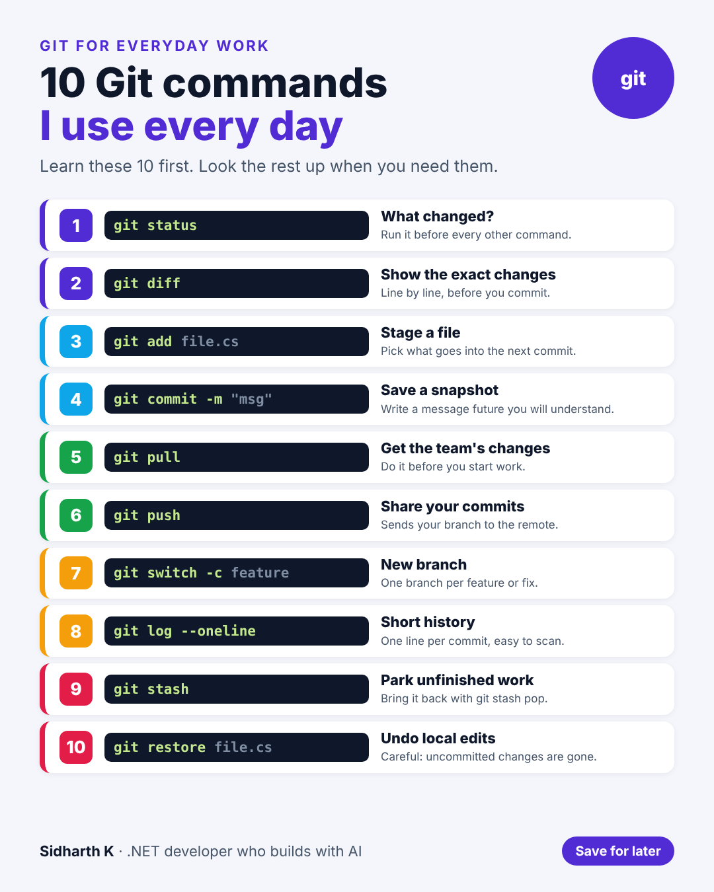

# 10 Git commands I use every day

- **Date:** Thu 26 Nov 2026, 9:00 AM IST
- **Format:** Image + caption
- **Status:** Ready




## Caption

```
Git has hundreds of commands. I use about 10 of them almost every day.

If you're new to Git, learn these first. You can look up the rest when you need them.

My habit: run git status before anything else. It tells you exactly where you are before you change anything.

Save this for your first week on a new team.

Which Git command do you use the most?

#Git #dotnet #SoftwareDevelopment
```
