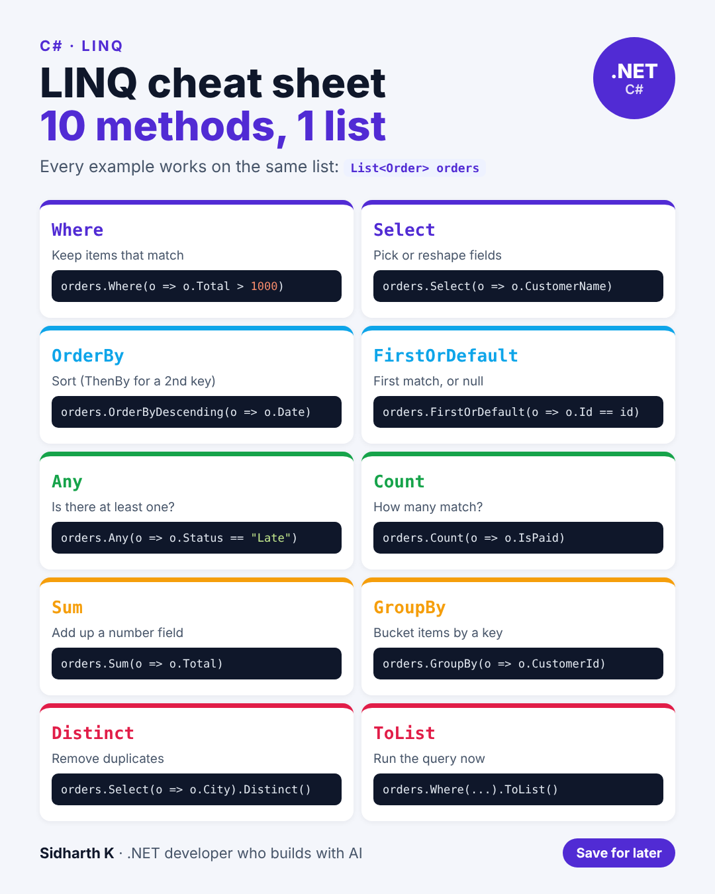

# LINQ cheat sheet

- **Date:** Thu 3 Dec 2026, 9:00 AM IST
- **Format:** Image + caption
- **Status:** Ready




## Caption

```
LINQ is one of the best reasons to write C#.

Filtering, sorting, grouping and adding up data in one readable line, instead of a loop with three if statements.

These are the 10 methods I'd learn first. Every example uses the same list of orders, so you can see how they compare.

One thing beginners miss: most LINQ queries don't run until you call something like ToList() or Count(). That matters a lot when the data comes from a database.

Save this one.

Which LINQ method do you use the most?

#csharp #dotnet #LINQ
```
