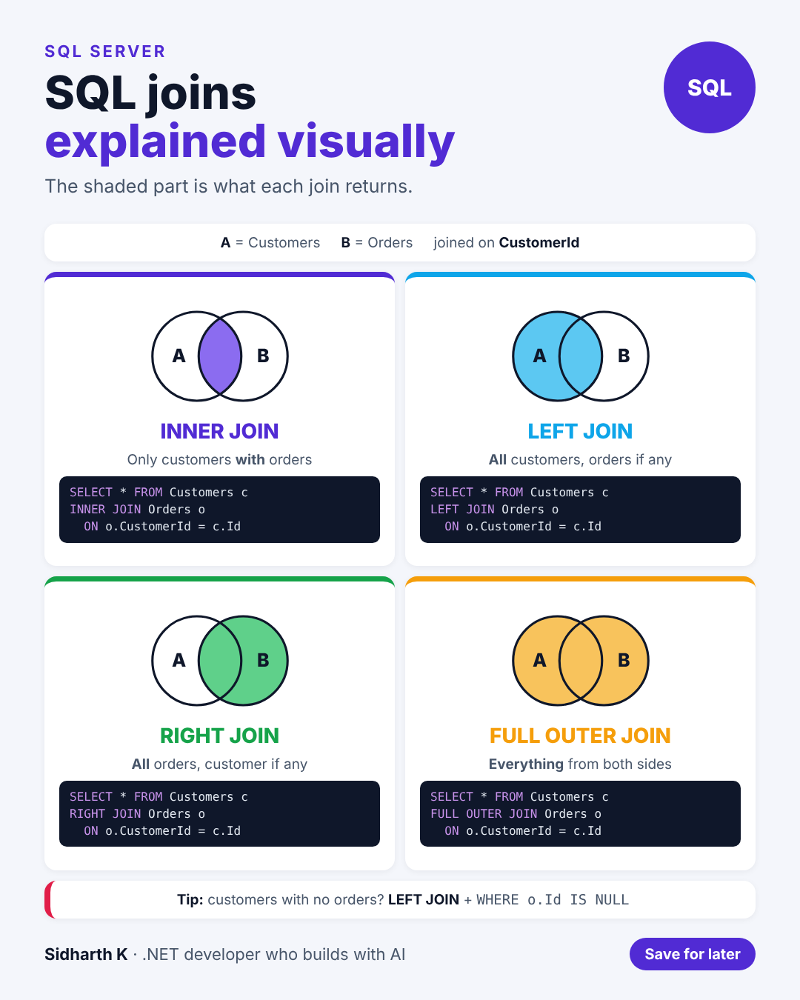

# SQL joins explained visually

- **Date:** Thu 10 Dec 2026, 9:00 AM IST
- **Format:** Image + caption
- **Status:** Ready




## Caption

```
SQL joins get much easier when you picture them as two circles.

INNER JOIN: only the overlap.
LEFT JOIN: everything on the left, plus matches.
RIGHT JOIN: everything on the right, plus matches.
FULL OUTER JOIN: everything from both sides.

The same two tables, Customers and Orders, are used in every example, so you can compare them directly.

Bonus trick in the image: how to find customers who never placed an order.

Save it for the next time a query returns more rows than you expected.

Which join do you use the most?

#SQL #SQLServer #dotnet
```
