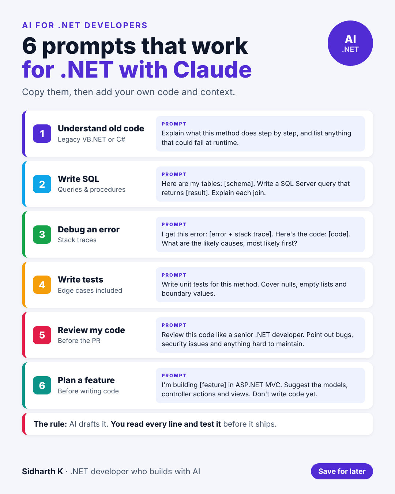

# 6 prompts that work for .NET with Claude

- **Date:** Thu 17 Dec 2026, 9:00 AM IST
- **Format:** Image + caption
- **Status:** Ready (swap in your own favourite prompts if you like)




## Caption

```
AI is only as useful as what you ask it.

Vague prompts like "fix this" or "write a query" get vague answers. Give the AI context, a clear task and a limit, and the answers get much better.

These 6 prompt patterns work well for everyday .NET work: understanding old code, writing SQL, debugging, writing tests, reviewing code and planning a feature.

And the rule at the bottom matters most: AI drafts it, you read every line and test it before it ships.

Save these and change them to fit your projects.

What's your most useful prompt for coding?

#AI #dotnet #Productivity
```
