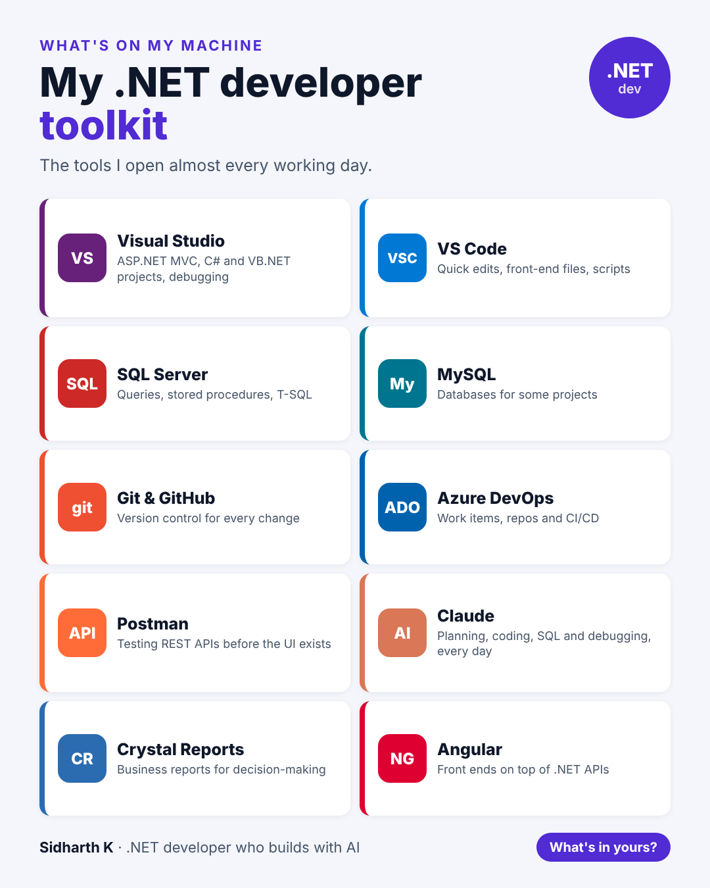

# My .NET developer toolkit

- **Date:** Thu 24 Dec 2026, 9:00 AM IST
- **Format:** Image + caption
- **Status:** Ready




## Caption

```
A lighter post for Christmas Eve: the tools I open almost every working day as a .NET developer.

Visual Studio for the main projects. SQL Server for the data. Git and Azure DevOps for every change. Postman for APIs. And Claude, which has become part of how I plan, write and debug code.

No fancy setup. Just tools that do their job.

What's one tool you can't work without?

Merry Christmas to everyone celebrating 🎄

#dotnet #DeveloperTools #Productivity
```
